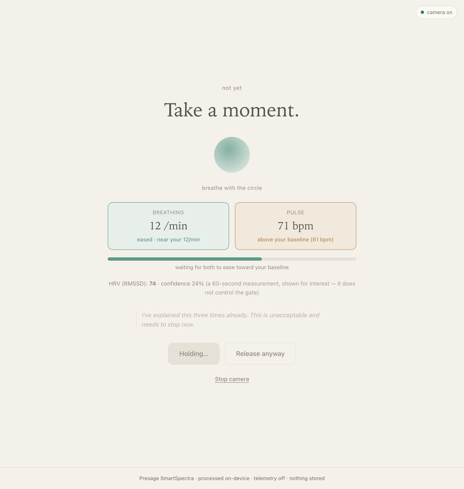

# Cooldown

**A pause between writing a heated message and sending it — gated on your own body settling.**

You write the message you're heated about. Before it releases, Cooldown waits until your **own** pulse and breathing rate have eased back toward the resting baseline it measured from you a minute earlier — contact-free, from a normal webcam, using the [Presage SmartSpectra SDK](https://github.com/Presage-Security/SmartSpectra). It never sends for you, and it never permanently blocks a message: you can release it yourself at any time.

It is not a wellness dashboard. A physiological signal **gates an action** — which is the honest version of "think before you hit send."



---

## How it works

1. **Consent** — plain-language card; the camera turns on only after you agree.
2. **Baseline (~30–75s)** — sit normally; Cooldown measures your resting pulse and breathing rate and takes the median of the clean readings (typically ~30–45s; longer if the signal is noisy). If it stays too noisy to trust, it says so rather than inventing a baseline.
3. **Compose** — type the message; watch your live pulse while you write.
4. **Cooldown** — press *Send* and it holds. Two meters show your **pulse** and **breathing rate** as *eased* (at/near your baseline) or *above your baseline*. Release requires **both eased**, **held steady for 15s**, **after a minimum pause** — with your HRV shown alongside purely for interest.
5. **Release** — when your body settles it opens: read it once more, then copy/send it or edit it. **"Release anyway" is always available** — a noisy camera must never trap your words.

## The signals (Presage SmartSpectra)

| Signal | Window | Role in Cooldown |
| --- | --- | --- |
| Pulse rate | ~12s | **Primary gate** — eased when at/near your baseline |
| Breathing rate | ~30s | **Secondary gate** — eased when at/near your baseline |
| HRV (RMSSD) | ~60s | **Informational only** — shown with its confidence; never gates |

These roles were chosen after a signal-validation pass on real hardware: pulse and breathing proved reliable with high confidence; HRV is slow and low-confidence within a single session, so it never controls the gate. A reading only counts when the SDK marks it `stable` **and** its confidence clears a floor — low-confidence "calm" readings are ignored, never treated as calm.

## Privacy & data handling

- **Camera only.** The microphone is never opened.
- **Nothing is recorded.** Frames are processed in-process by the SDK; the video is never displayed, saved, or transmitted. Only derived numbers (pulse, breathing, HRV) are used.
- **No account, no cloud, no database, no files.** Close the app and nothing remains.
- **SDK telemetry is disabled** explicitly (`enableTelemetry: false`). The SDK still makes authenticated network calls to Presage to load its models and verify usage — so the app is not fully offline, but no measurements or frames are sent by this app.
- **Local only.** The UI is served on `127.0.0.1` and gated by a per-run token; the event stream and controls reject other origins and bad tokens.
- **Not a medical device.** Cooldown shows measurements; it never claims to know your emotional or medical state.

## Run it

Requires Node 20+ (tested on Node 24/25, macOS arm64) and a free Presage API key.

```bash
# 1. get a free key: https://physiology.presagetech.com/auth/register
#    put it in a local file (never commit it):
echo "YOUR_KEY" > presage.key

# 2. install + run
npm install
npm start
# open the printed http://127.0.0.1:4799/?t=… URL
```

Demo pacing (shorter pause/hold for recording a full arc):

```bash
COOLDOWN_DEMO=1 npm start
```

## Tests

Pure gate/baseline logic is unit-tested with no camera needed:

```bash
npm test
```

## Notes

- The Presage SmartSpectra SDK is proprietary and is **not** redistributed here; `npm install` pulls it under [Presage's Terms of Service](https://physiology.presagetech.com/tos). Bring your own key.
- `harness.mjs` is the Phase-1 signal-validation tool used to confirm the signals and learn the metric schema on real hardware.
